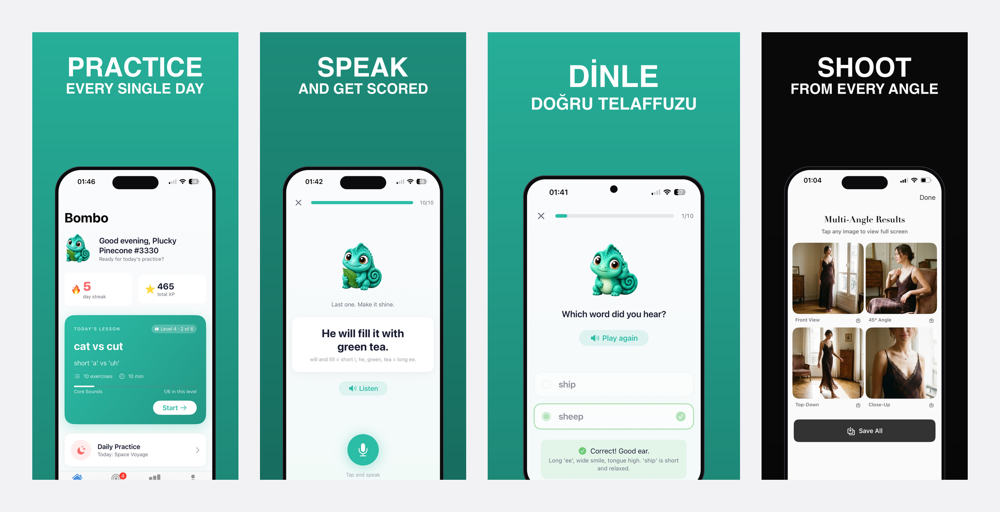

# storeshots-mcp

**Generate App Store and Google Play screenshots from the command line, or let your AI coding agent do it.**

storeshots turns raw app screenshots into finished store-listing visuals — device frames, benefit-driven headlines, brand backgrounds, and exact store dimensions for iOS and Android. Describe your whole listing in one `storeshots.json`, run `storeshots build`, and get every platform in every language. Your AI agent (or you) writes and translates the copy; storeshots renders the pixels. It's a CLI first, with an [MCP](https://modelcontextprotocol.io) server for agents that have no shell. No design tool, no subscription, no API keys.

<p align="center">
  
</p>

<p align="center">
  <sub>Real screens from two shipped apps: <a href="https://apps.apple.com/app/id6774954831">bombo</a> (panels 1–3) and <a href="https://apps.apple.com/app/id6756270620">Studio Zero</a> (panel 4). Panel 3 is the Android preset with Turkish headlines, uppercased with locale-correct <code>İ</code> and <code>Ğ</code>.</sub>
</p>

<p align="center">
  <a href="https://www.npmjs.com/package/storeshots-mcp"></a>
  <a href="https://github.com/mtbun/storeshots-mcp/actions/workflows/ci.yml"></a>
  
  
  
  <a href="https://glama.ai/mcp/servers/mtbun/storeshots-mcp"></a>
</p>

---

## The idea

Store screenshots are two jobs pretending to be one. There's a **creative** job (what to say, which screen sells which feature, how to phrase it in six languages) and a **production** job (frames, typography, exact pixel dimensions, no alpha channel). Design tools make you do both by hand; screenshot SaaS locks the production job behind a subscription.

storeshots-mcp splits them and gives each to whatever is best at it:

| Your AI agent decides | storeshots renders |
|---|---|
| Which screens to feature | Device frames at exact scale |
| The headline for each one | Typography, contrast, and layout |
| Idiomatic translations | Correct casing per language (Turkish `İ`, German `ß`) |
| Brand color and order | Deterministic PNGs at exact store dimensions |

Because the render path is pure and local, the same inputs always produce the same pixels — no model in the loop, nothing uploaded anywhere.

## Quick start

```bash
npx storeshots init --langs en,tr --bg "#E31837"   # finds ./screenshots, writes storeshots.json
# replace the TODO headlines in storeshots.json
npx storeshots build --watch                       # renders everything, re-renders on save
```

`init` lists your raw screenshots (from `screenshots/`, `raw-shots/`, `raw/`, `shots/` or `fastlane/screenshots/`, or `--screens <dir>`) in a config like this:

```jsonc
{
  "background": "#E31837",
  "presets": ["ios-phone", "android-phone"],
  "languages": ["en", "tr"],
  "outputDir": "output",
  "screens": [
    { "screenshot": "screenshots/home.png",
      "copy": { "en": ["Track", "your daily mood"], "tr": ["İzle", "günlük ruh halini"] } },
    { "screenshot": "screenshots/stats.png", "variant": "tilted",
      "copy": { "en": ["Discover", "weekly insights"], "tr": ["Keşfet", "haftalık içgörüler"] } }
  ],
  "featureGraphic": { "screen": 1 },   // optional: Play Store 1024 × 500 header
  "showcase": true                     // optional: one preview strip per set
}
```

`build` renders every screen × preset × language:

```
output/
  en/ios-phone/en_01.png … en_06.png
  en/android-phone/en_01.png …
  en/play-feature-graphic/en_feature.png
  tr/ios-phone/tr_01.png …
  showcase/en_ios-phone.png …
```

Rendering is deterministic, so `build` only redraws what changed: edit one Turkish headline and only that file is rendered again. Delete a screen and its old files are removed. Every output is checked against its store's rules before it's written.

Install globally with `npm i -g storeshots-mcp` if you'd rather type `storeshots` than `npx storeshots`.

### Commands

| Command | What it does |
|---|---|
| `storeshots init` | Create `storeshots.json` from a folder of raw screenshots, and add a storeshots section to AGENTS.md / CLAUDE.md |
| `storeshots build` | Render the whole config. `--watch`, `--lang tr`, `--preset ios-phone`, `--dry-run`, `--force`, `--jobs 4` |
| `storeshots compose` | Render one screenshot from flags, no config needed |
| `storeshots showcase` | Stitch images or folders into one preview strip |
| `storeshots validate` | Check files or whole folders against store rules (exits 1 on failure, so it fits CI) |
| `storeshots presets` | List presets and exact dimensions |

After a first successful build, storeshots asks once whether you'd like to star it on GitHub. It never asks in CI; set `STORESHOTS_NO_STAR=1` to turn it off. Every command takes `--json` for machine-readable output and `--help` for details. Exit codes: `0` ok, `1` render or validation failure, `2` bad usage or config. Config errors list every problem at once, each with its path (`screens[2].copy.tr: missing`).

### Config reference

| Field | |
|---|---|
| `background` | Brand color, 6-digit hex. Required. |
| `presets` | Any of `ios-phone`, `android-phone`, `ipad-13`, `android-tablet`. Default: both phones. |
| `languages` | BCP-47 codes. Default: the languages in the first screen's `copy`. |
| `screens[]` | Up to 10, in store order. Each takes a `screenshot`, a `copy` per language (`["verb", "descriptor"]` or `{"verb", "descriptor"}`), and optionally its own `variant` or `background`. |
| `screens[].screenshot` | A path relative to the config. Use `{lang}`, `{preset}` and `{platform}` (`ios`/`android`) for localized or per-platform captures, e.g. `"shots/{platform}/{lang}/home.png"`. You can also give an object keyed by preset id, with a `"default"` fallback. |
| `variant` | `text-top` (default), `text-bottom`, or `tilted`. Applies to the whole set; a screen's own `variant` overrides it. |
| `panorama` | `{ "to": "#hex" }`: one gradient flowing from `background` across every panel. |
| `frame` | A [custom frame](#custom-frames), or one per preset id. |
| `featureGraphic` | `{ "screen": n }` reuses a screen's shot and copy. You can also give `screenshot`, `copy` and `background` directly. |
| `showcase` | `true` writes a preview strip per language and preset into `output/showcase/`. |
| `outputDir`, `noGradient` | Output folder (default `output`). `noGradient` turns off the subtle vertical gradient. |

## With an AI agent

storeshots splits the creative work from the production work. Your agent reads your app, picks a benefit for each screen, writes and translates the headlines into `storeshots.json`, and runs `storeshots build`. That needs no setup in any agent that has a shell: Claude Code, Cursor, Codex, Windsurf and others. For the guided flow, install the [Claude Code plugin](#agent-setup).

> "Take the screenshots in `./raw-shots` and make a full App Store and Play Store set. Brand color `#E31837`, English and Turkish."

**MCP server.** For clients without a shell (Claude Desktop, for example), the same engine runs as a stdio MCP server:

```bash
claude mcp add storeshots -- npx -y storeshots-mcp
```

```json
{ "mcpServers": { "storeshots": { "command": "npx", "args": ["-y", "storeshots-mcp"] } } }
```

Codex CLI uses `~/.codex/config.toml`:

```toml
[mcp_servers.storeshots]
command = "npx"
args = ["-y", "storeshots-mcp"]
```

## What it produces

**5 presets, each at the exact size its store requires:**

| Preset | Store | Dimensions |
|---|---|---|
| `ios-phone` | App Store, iPhone 6.9" | 1320 × 2868 |
| `android-phone` | Google Play, phone | 1080 × 1920 |
| `ipad-13` | App Store, iPad Pro 13" | 2064 × 2752 |
| `android-tablet` | Google Play, 10" tablet | 1600 × 2560 |
| `play-feature-graphic` | Google Play feature graphic | 1024 × 500 |

**And the finishing touches that make a set look designed:**

- **Built-in device frames** — iPhone (dynamic island), Pixel-style Android (punch hole), iPad, and tablet, drawn programmatically at exact scale. Bring your own with [custom frames](#custom-frames).
- **Layout variants** — `text-top`, `text-bottom`, and `tilted`; mix them across a set so it doesn't look like one template copied six times.
- **Panoramic sets** — one gradient flowing continuously across every panel, so the row reads as a single image in the store. See [panoramas](#panoramic-sets).
- **Benefit-first headlines** — a bold verb plus a short descriptor, auto-uppercased with locale-correct special characters and contrast-aware color.
- **Showcase composer** — one wide preview image of the whole set for your repo, launch post, or client deck.

Every output is flattened to remove the alpha channel that App Store Connect rejects, and validated against its preset before it's written.

## MCP tools

| Tool | What it does |
|---|---|
| `build_project` | Build a `storeshots.json`, re-rendering only what changed. This is the same engine as `storeshots build`. |
| `generate_set` | Batch-render an ordered set for one platform and language. Supports panoramas. |
| `compose_screenshot` | Render one screenshot (background, frame, headline, source image) |
| `create_showcase` | Stitch generated screenshots into one preview strip |
| `validate_screenshot` | Check an image against store dimension and format rules |
| `list_presets` | List every preset with its store and exact dimensions |

Each tool returns file paths plus a structured summary, so the agent can review and iterate.

## Multi-language sets

Translation happens in the agent, not in storeshots. Add a language key to each screen's `copy` and storeshots renders it with locale-correct casing: Turkish `i` → `İ`, German `ß` is kept. `storeshots build --lang de` rebuilds a single language.

## Panoramic sets

Add `"panorama": { "to": "#1E3A8A" }` and each panel's solid background becomes one horizontal gradient sliced across the whole set. Placed side by side in the store, the screenshots then read as a single continuous image.

## Custom frames

Prefer a specific device look? Supply your own frame PNG (transparent where the screen shows through) and the pixel rectangle the screenshot fills:

```jsonc
{
  "frame": {
    "image": "./frames/iphone-16-pro.png",
    "screenX": 40, "screenY": 40,
    "screenWidth": 1080, "screenHeight": 2280
  }
}
```

Use it as `"frame"` in `storeshots.json`, either one frame for every preset or `{ "ios-phone": {…}, "android-phone": {…} }`. You can also pass it to `storeshots compose --frame frame.png --frame-screen 40,40,1080,2280`, or to the `compose_screenshot` and `generate_set` tools. Paths are relative to the config, and a changed frame image triggers a re-render. Leave it out to use the built-in frames.

## Agent setup

**Project instructions.** `storeshots init` adds a short, marker-delimited storeshots section to your project's agent instruction file. Coding agents (Claude Code, Codex, Cursor and others) then know how this project's screenshots are made: edit `storeshots.json`, run `storeshots build`, and never hand-edit the PNGs.

- It uses `AGENTS.md` and/or `CLAUDE.md`, whichever already exist. When CLAUDE.md just imports `@AGENTS.md`, only AGENTS.md gets the section.
- If neither file exists, it creates `AGENTS.md` plus a `CLAUDE.md` that imports it.
- Rerunning updates the section in place. `--no-agents` skips it, and `storeshots init --agents-only` adds it to an existing project.

**Claude Code plugin.** The bundled skill adds a guided workflow. It discovers a benefit for each screen from your codebase and gets your approval on headlines before rendering. It then keeps `storeshots.json` up to date, adds languages, and walks you through the upload.

```
/plugin marketplace add mtbun/storeshots-mcp
/plugin install storeshots@storeshots
```

Then ask Claude Code for "store screenshots for this app".

**[llms.txt](llms.txt)** summarizes the commands and config format in one file for agents.

## Design principles

1. **Deterministic** — no AI image generation in the render path; same input, same pixels.
2. **Zero config** — no API keys, no accounts, fully offline.
3. **Store-correct by construction** — dimensions are enforced and validated, not suggested.
4. **Agent-native** — tools expose structured data; the copywriting stays in the model where it belongs.

## Roadmap

- [x] Claude Code skill with a guided benefit-discovery workflow
- [x] Play Store feature graphic preset (1024 × 500)
- [x] Layout variants — text-top, text-bottom, tilted
- [x] Custom device frames
- [x] Panoramic sets
- [x] Project config with incremental `build` and `--watch`
- [x] Claude Code plugin and AGENTS.md / CLAUDE.md integration
- [ ] App preview video frames
- [ ] More stores (Mac App Store, Chrome Web Store)

## Contributing

Issues and PRs welcome. [AGENTS.md](AGENTS.md) documents the architecture and conventions, for human contributors and coding agents alike.

## License

[MIT](LICENSE)
